# FlashTrace

FlashTrace checks a web page for **hazardous flashing** against WCAG 2.2 Success Criterion **2.3.1 Three Flashes
or Below Threshold**. It records the page as still frames under a controlled clock, measures every 4 × 4 px patch
of every frame with the W3C formulas, finds which element on the page causes a failing flash, proposes a CSS fix,
and re-runs the audit to check that the fix works.

> **Analysis aid, not a compliance certification.** A PASS means *no 2.3.1 violation was detected under the
> tested conditions* (this viewport, this duration, this browser). It does not certify a page.

Built for the Congressional App Challenge by one student. Everything runs on your own computer: no accounts, no
paid services, no AI inside the product, and the same page with the same settings always gives the same frames and
the same report.

## Why it matters

Flashing content can trigger seizures in people with photosensitive epilepsy. WCAG 2.3.1 says a page must not
contain anything that flashes more than three times in any one second, unless the flash is too dim or too small.
Checking that by eye is unreliable and unsafe. FlashTrace checks it with the W3C's own numbers and shows its
evidence as still frames only.

## Safety first

* FlashTrace's own screens never flash. Evidence is shown as still frames, and you step through frames by hand
  (Previous / Next); nothing auto-plays. Motion in the viewer is one-shot and short, switches off with your
  system's *reduce motion* setting, and is itself audited by FlashTrace (see `tests/test_ui_self_audit.py`).
* The demo site **does flash on purpose** (it is the thing to find). `flashtrace demo` opens a warning page
  first; the audit does not need anyone to look at the flashing page.

## Install

You need Python 3.11 or newer. Node 20 or newer is only needed to build the web viewer.

```bash
python3 -m venv .venv
```

```bash
source .venv/bin/activate
```

```bash
pip install -e ".[dev]"
```

```bash
python -m playwright install chromium
```

Optional, for `flashtrace serve` (the web viewer):

```bash
cd web && npm ci && npm run build
```

After installing, FlashTrace works offline.

## Quick start

Start the demo site (a fictional sports page with a strobing loader and a pulsing red LIVE badge):

```bash
flashtrace demo
```

In a second terminal, audit it, find the cause, and write an HTML report:

```bash
flashtrace audit http://127.0.0.1:8765/site/ --attribute ablate --html report.html --out report.json
```

List the proposed fixes, then verify the first one by re-capturing the page with it applied:

```bash
flashtrace fix report.json
```

```bash
flashtrace fix report.json --apply 1 --verify
```

Or use the web viewer for everything (new audit, live progress, report, history):

```bash
flashtrace serve
```

Then open http://127.0.0.1:8001.

### Commands

| Command | What it does |
|---|---|
| `flashtrace audit <url-or-file>` | Captures and analyses one page. Options: `--duration` (default 10 s), `--viewport` (default 1024x768, the WCAG reference size), `--fps` (default 60), `--script` (JavaScript run before frame 0, e.g. to open a menu), `--attribute none\|bbox\|ablate` (default bbox), `--out`, `--html`, `--json`, `--no-fail`, `--red-rule`, `--strategy`. |
| `flashtrace fix <report.json>` | Lists fixes; `--apply N` prints fix N (counting from 1); `--apply N --verify` re-captures with it and records before/after. |
| `flashtrace bench` | Generates 200 synthetic test pages with known answers and scores FlashTrace against them; writes `docs/RESULTS.md`. |
| `flashtrace demo` | Serves the demo site on 127.0.0.1:8765. |
| `flashtrace serve` | Runs the local API and web viewer on 127.0.0.1:8001, one audit at a time. |

Exit codes for `audit`: **0** PASS, **1** FAIL (and INCONCLUSIVE unless `--no-fail`), **2** error.

## How it works

```mermaid
flowchart LR
  A["Page<br/>(URL or file)"] --> B["Capture<br/>Chromium, controlled clock,<br/>600 still frames"]
  B --> C["Engine<br/>luminance + red per 4x4 px cell"]
  C --> D["Transitions to flashes<br/>per cell"]
  D --> E["Area<br/>more than 25% of a<br/>341x256 px window?"]
  E --> F["Rate<br/>more than 3 per second?"]
  F --> G{"Verdict"}
  G -- FAIL --> H["Attribution<br/>overlap, then ablation"]
  H --> I["CSS fix<br/>from measured colours and rates"]
  I --> J["Verify<br/>re-capture with the fix"]
```



In words:

1. **Capture** (`capture/`). Chromium loads the page with its clock frozen. For each frame FlashTrace moves every
   animation, video and timer forward by exactly 1/60 s and takes a screenshot, so the frames do not depend on how
   fast the computer is. Pages whose animation cannot be controlled (animated GIFs, WebGL, cross-origin frames) are
   recorded in real time instead, and then a PASS is reported as INCONCLUSIVE.
2. **Measure** (`engine/`). Each frame is split into 4 × 4 px cells. For each cell FlashTrace computes relative
   luminance with the WCAG formula and checks for saturated red.
3. **Transitions and flashes.** A transition is a rise or fall between a peak and a valley of a cell's brightness
   that changes luminance by 0.10 or more while the darker state is below 0.80. Two opposite transitions make one
   flash. Red flashes use the WCAG 2.2 saturated-red rule.
4. **Area.** A moment counts only if the cells flashing together cover more than 25% of some 341 × 256 px rectangle
   (WCAG's stand-in for 10° of your vision at 1024 × 768).
5. **Rate.** More than 3 such flashes of one type inside any one-second window is a **FAIL**.
6. **Attribution** (`capture/attribute.py`). FlashTrace lists the page elements under the failing area and ranks
   them by overlap. With `--attribute ablate` it re-records the page with each suspect frozen or hidden and keeps the
   smallest set of elements whose removal makes the page pass.
7. **Fix and verify** (`capture/fix.py`). From the measured colours and rates it proposes CSS: slow the animation to
   at most 2.5 flashes per second, reduce the brightness difference below 0.10, take saturated red below the red
   limit, or (never applied automatically) shrink the area. Verifying injects the CSS and runs the whole audit again.

The exact W3C wording, every threshold and every interpretation are in [docs/SPEC.md](docs/SPEC.md); the reasons
for each choice are in [docs/DECISIONS.md](docs/DECISIONS.md); the engine is explained step by step for
non-experts in [docs/ENGINE.md](docs/ENGINE.md).

## Accuracy

FlashTrace is measured on 200 generated pages whose correct answers are known from how they were built (five
animation mechanisms: CSS, Web Animations, JavaScript, canvas, video; rates from 1 to 10 per second; areas around
the 25% limit; brightness steps around the 0.10 limit; red and non-red; distracting animations that must not be
flagged). Cases within a few percent of a limit are reported separately.

All accuracy, determinism and speed figures are in [docs/RESULTS.md](docs/RESULTS.md). That file is written only by
`flashtrace bench`, with the date, commit and exact command, so no number in it is typed by hand.

## In CI (GitHub Action)

```yaml
- uses: actions/checkout@v4
- uses: ./action
  with:
    url: http://localhost:3000/
    duration: 10
```

The job fails on FAIL (and on INCONCLUSIVE unless `fail-on-inconclusive: false`) and uploads the JSON and HTML
reports. See [action/README.md](action/README.md).

## Limitations

These are also listed inside every report:

* Headless sRGB rendering is not a physical display; brightness, gamma and viewing distance differ per user.
* Canvas and WebGL attribution is element-level only: FlashTrace can name the canvas, not what is drawn in it.
* Cross-origin iframes cannot be inspected or clock-controlled; they are reported as unattributable regions.
* Animated GIF, WebP and APNG images force real-time capture, so a PASS becomes INCONCLUSIVE.
* The fine-pattern exception and spatial-pattern hazards are not evaluated.
* Only the captured viewport and duration are analysed; content shown by scrolling or clicking is analysed only if a
  `--script` drives it.
* Flashing faster than half the frame rate (30 per second at 60 fps) cannot be seen in the frames.
* For viewports that are not 1024 px wide, the 341 × 256 px window is scaled by the width ratio (an assumption).

## Project layout

| Folder | Contents |
|---|---|
| `engine/` | Pure NumPy analysis: colour, cells, transitions, area, rate, verdict. Unit tests in `engine/tests/`. |
| `capture/` | Playwright capture strategies, attribution, fixes and verification. |
| `cli/` | The `flashtrace` command, report assembly, HTML export. |
| `server/` | FastAPI local server and job runner. |
| `web/` | Next.js report viewer (static export served by the server). |
| `bench/` | Synthetic benchmark generator, truth file, scorer. |
| `demo/` | The deliberately flashing demo site and its warning page. |
| `action/` | GitHub Action wrapper. |
| `docs/` | SPEC, DECISIONS, ENGINE, API, STATUS, RESULTS. |

## AI disclosure

AI assistance was used to build this repository and is logged in detail, by date, in [AI_USAGE.md](AI_USAGE.md),
as the Congressional App Challenge requires. No AI runs inside FlashTrace itself.

Analysis aid, not a compliance certification.
